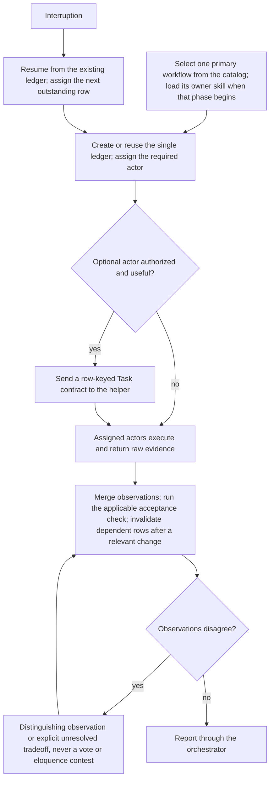

Load when assigning workflow roles or Octocode tools, sequencing work, running parallel write lanes, merging evidence, handing off, or resuming.

# Composition

## Orchestrator and actor contract

RACI for every workflow execution, which has one orchestrator and at least one actor. Honor user-directed actor assignments and sequence before considering optional splits. The workflow assigns the required actor; an optional actor still needs a distinct check or required capability and must stay within the user's authority.

| RACI slot | Who | Duties |
|---|---|---|
| Accountable | Orchestrator | Owns the user goal, authority, primary workflow, actor selection, sequence, one ledger, evidence merge, verification, and user-facing result. Sends each actor a Task contract with a bounded input (table below). |
| Responsible | Each actor | Executes only its assigned steps, preserves raw evidence, and returns observations keyed to the orchestrator's ledger row. Creates no other ledger and never marks the work accepted. Requests another role from the orchestrator; there is no nested, unsupervised orchestrator or recursive spawning. |
| Consulted | Owner skill | Keeps its method, permissions, and output. |
| Informed | User | Receives the orchestrator's result. |

| Assignment: Task contract + Definition of Done | Actor return: claim–evidence, keyed to the row | Orchestrator merge |
|---|---|---|
| Objective: goal/scope, target boundary; inputs: relevant Octocode access and anchors; constraints: authority (read/write/process), role; Definition of Done: acceptance condition; next row | Row key; exact source/runtime anchors, relevant non-secret conditions, expected and observed result; counterevidence/gap; requested next action | Re-read deciding anchors, check applicability and identity, retain disproof/uncertainty, update the one ledger |

Use `octocode-agents-communication` for identity, leases, requests, completion, and durable delivery. A delivered handoff is not a verified result. One source/build owner writes a changed boundary; one process owner changes a target process. Inspectors return evidence rather than racing the writer with fixes.

For an independent check, give the checking actor the requirement, owner contract, and raw inputs before the producer's conclusion when feasible. It derives its own acceptance or distinguishing check and returns primary anchors. Two summaries of the same shared observation do not corroborate each other; the orchestrator records overlapping evidence rather than counting it twice.

Keep the acceptance oracle stable. A builder cannot weaken an assertion or redefine success to pass. An oracle correction needs owner-contract evidence, a versioned comparison, preservation of the old result, and invalidation of affected rows/comparisons; the orchestrator records the change without forcing acceptance.

## Parallel write lanes

When several actors change one repository at once, partition the writing before launch.

| Concern | Rule |
|---|---|
| Ownership | Each Task contract names the paths the actor owns and the owner of each neighboring path. A fix needed outside the actor's paths goes back as a request in its return, never as an edit. Where two lanes must share a file, each makes small exact edits and re-reads the file on conflict. |
| Shared mutable resources | Generated artifacts get one locked regenerate command. The orchestrator owns the build and the lockfile. Lanes share one build cache, never a private target or cache directory each. |
| Contract-breaking change | The orchestrator lands the upstream contract change and regenerates before lanes adapt to it. Otherwise one lane owns the change and every consumer it breaks. |
| Half-finished neighbors | A compile or test failure in another lane's files is re-run before it is blamed. If it persists, report it with the file and line. |
| Redirect | When evidence contradicts a lane's direction, send it the measured evidence, the new target, and what to remove. Stopping early costs less than merging the wrong design. |
| User hold | "Plan first" or a design question pauses every edit the plan would change. Lanes continue only the work the plan leaves unchanged. |
| Foreign effects | When something outside the lanes changes shared state (index staging, background jobs), report it. Never stash, reset, or overwrite to hide it. |

Size a lane by its files and checks, not by item count. Once its return is in, re-read the deciding anchors before accepting, as in [Diagnose and replan](verification.md#diagnose-and-replan-from-evidence).

## Octocode tools for every role

The [shared tool-access rule](../SKILL.md#use-octocode-across-workflows) applies to all catalog cards and metaphors. Assign the evidence question and relevant checkout/ref or entry point; let the actor choose and refine its calls. The orchestrator can use the same tools to scope work, resolve disagreements, and verify returned anchors without taking over actor duties.

Use the [shared MCP/CLI guide](octocode-usage.md) for invocation, live availability, pagination, and recovery. The capability map below connects tools to workflow roles.

| Evidence needed, in any workflow | Useful Octocode capability and application |
|---|---|
| Locate an owner or verify a written claim | `structureSearch`, `localSearch`, and `localFetch`: locate and read implementation, tests, configuration, docs, prompts, skills, or permitted memory files. Useful for writing, planning, critique, and maintenance as well as code investigation. |
| Understand shape or repeated logic | `astSearch`: find declarations, branches, duplicate patterns, and candidate paths for traversal, algorithms, cleanup, or architecture work. |
| Resolve identity or impact | `lspSearch`: confirm definitions, references, callers, and consumers before a refactor, deletion, protocol change, or acceptance judgment. |
| Check upstream facts or explain a change | GitHub search/read/history tools and `artifactSearch`: inspect pinned source, changes, package versions, and dependencies for research, brainstorming, RFCs, and reviews. |
| Connect observed behavior to implementation | Local search/read plus AST/LSP: trace a runtime or browser observation through handlers, state, and consumers; inspect scraper extraction and normalization. Pair source evidence with the domain's live observation or replay. |
| Find a resource-flow bottleneck | Local search/read plus AST/LSP: trace instruction loaders, cache keys, invalidation, queues, allocations, and lifetimes. The plumber pairs these anchors with measurements before claiming an efficiency or memory benefit. |
| Check an instruction or evaluation pipeline | Search/read the effective prompt loader, schema, fixture, grader, and result consumer. Inspect only evidence permitted by the evaluation phase; retain held-out boundaries. |
| Resume or independently verify work | Reopen exact source anchors and recheck affected consumers against current identity. Communication tools carry assignments and evidence; Octocode research tools check repository claims in them. |

Apply the [shared evidence rules](evidence.md). Return capability gaps to the orchestrator, or use the domain's supported alternative; an unavailable call is not a completed check.

## Compose and resume

- Add a helper only for a stated condition and within the user's authorized sequence. A user's request to work sequentially excludes optional concurrent lanes.
- Reject a split when the second role only paraphrases, lacks decisive access, cannot check independently, or costs more coordination than the bounded work. Actors request additional roles from the orchestrator; they do not create nested teams.
- Resume is Checkpoint–resume with the ledger as the checkpoint: done is the `verified` rows, next the next outstanding row, open questions the gaps. Reread the existing ledger, reconcile it with current source/artifact/state identity, retain only evidence with a dependency basis, and assign the next outstanding row. Do not create a replacement ledger.

When a workflow needs unavailable actor tools, report it as an SBAR: situation (the missing role or tool), background (the workflow and row), assessment (the affected check), recommendation (what to supply or accept). Do not convert the orchestrator into an undisclosed actor. A direct task outside this workflow has no orchestrator wrapper.

Next: choose a concrete split in [role patterns](role-patterns.md) or execute the selected procedure.
