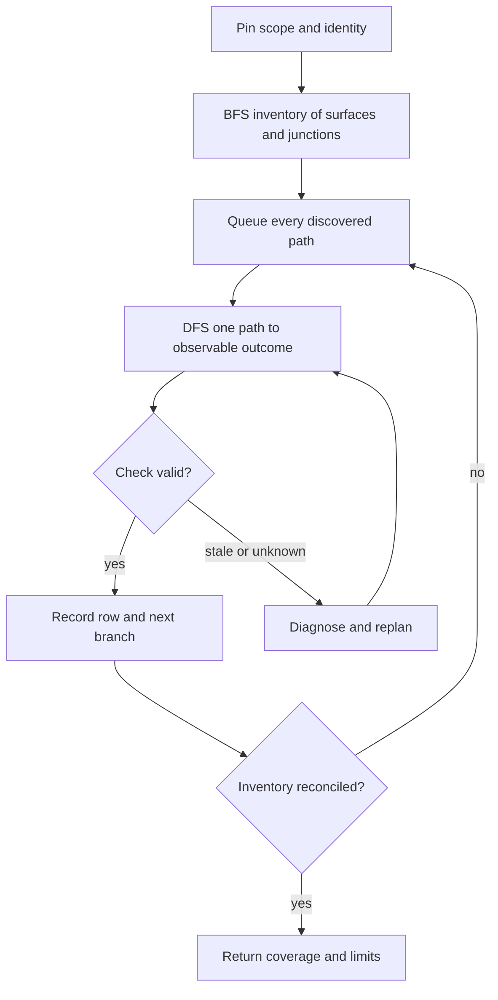

Load when one traversal actor must inspect a declared whole-codebase and running-application scope with breadth-first and depth-first traversal.

# Single-actor BFS/DFS audit

The orchestrator assigns one traversal actor the complete audit loop. It owns discovery, trace execution, authorized edits, rebuild requests, and observations; it returns them to the orchestrator's ledger. Do not fan out or spawn workers in this workflow.

## Traverse

- Pin roots, revision, existing uncommitted work, entry points, configuration, runtime target, and exclusions. Inventory manifests, registrations, schemas, exports, configuration, live catalogs, adapters, jobs, callbacks, and lifecycle entry points.
- BFS every junction: branch, dispatch, adapter, shared service, fan-in/out, or ownership/state/control boundary. Rank critical paths for order, never exclusion. Queue each discovered path as a `queued` row [named](verification.md#keep-one-compact-coverage-ledger) by resolved identity plus bounded configuration/scenario identity; one visited file never covers every incoming contract. After each BFS pass, dedupe with [ledger.mjs](../scripts/ledger.mjs): `node <skill-folder>/scripts/ledger.mjs <coverage.md> --dedupe --write` removes rediscovered `queued` rows. Exit 1 with a `duplicates` group that keeps two or more lines means one identity holds two check results: merge their evidence into one row.
- DFS `input → validation → dispatch → implementation → state/dependency → output → consumer`, including supported success, denial, empty, partial, failure, cancellation, retry, timeout, cleanup, and dynamic/registered paths. Keep the pending BFS frontier and DFS stack/resume point beside the ledger for interruption and replan.
- Use Research for live schemas and continuations; use [AST/LSP](ast-lsp-workflows.md) for candidates and semantic checks; use `octocode-engineer`, when installed, for review angles and authorized change discipline.
- For runtime rows use the [identity guard](verification.md#automatically-check-artifact-identity). Source-only rows name their source/index scope. Missing fixtures, access, services, or tools remain explicit gaps.

## Repair and completion

The actor reports a proven boundary and focused evidence; the orchestrator decides authorized change sequencing and requeues affected callers, consumers, junctions, and scenarios after invalidation. Stop condition and claims:

| Claim | Holds only when |
|---|---|
| Traversal exhausted | The BFS/DFS frontier is empty and every discovered surface is accounted for in the ledger |
| Full verification | Exhausted, source and live inventories reconcile, and `node <skill-folder>/scripts/ledger.mjs <coverage.md> --claim full` exits 0. Exit 1: each row in `blockingRows` (not `verified`, or missing its check or evidence) prevents the claim. Exclusions stay in the pinned scope, not in the ledger. |
| “All checked” | It covers the declared inventory and scenarios, never a visited-file set or arbitrary sample |

Next: apply [verification](verification.md) and return the domain result through the orchestrator.
